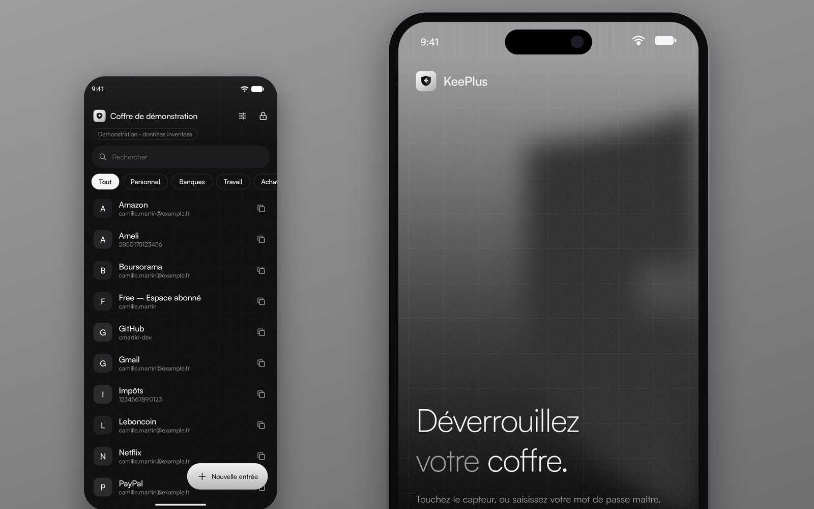
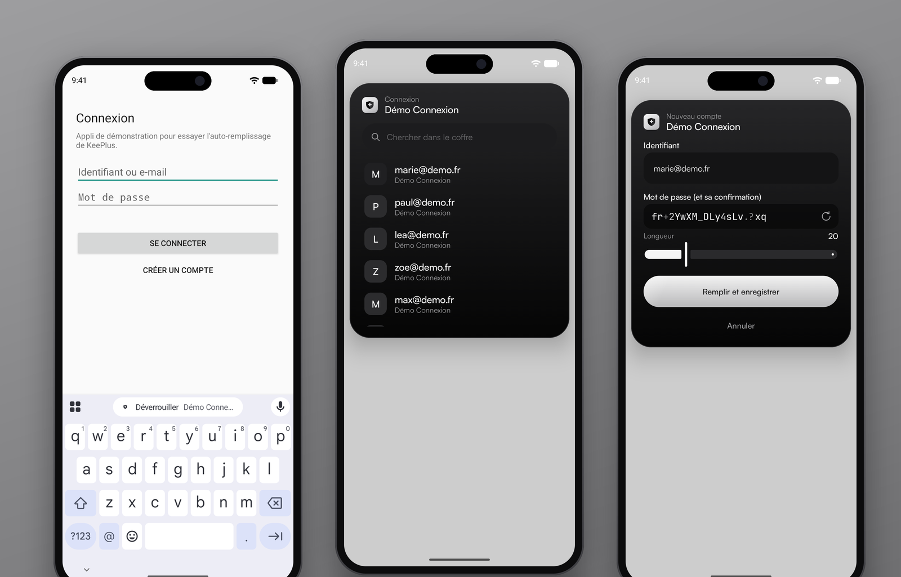
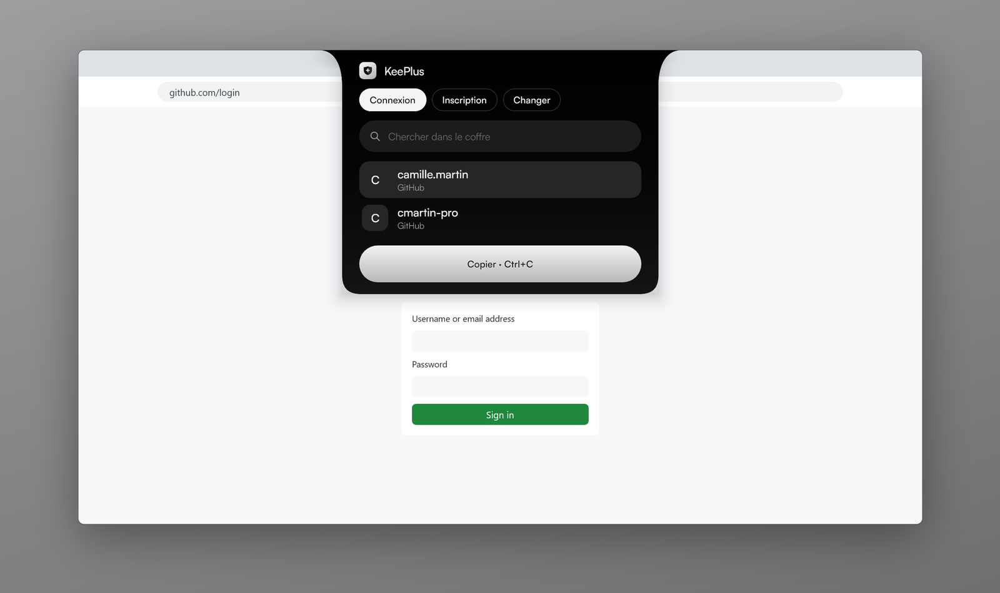
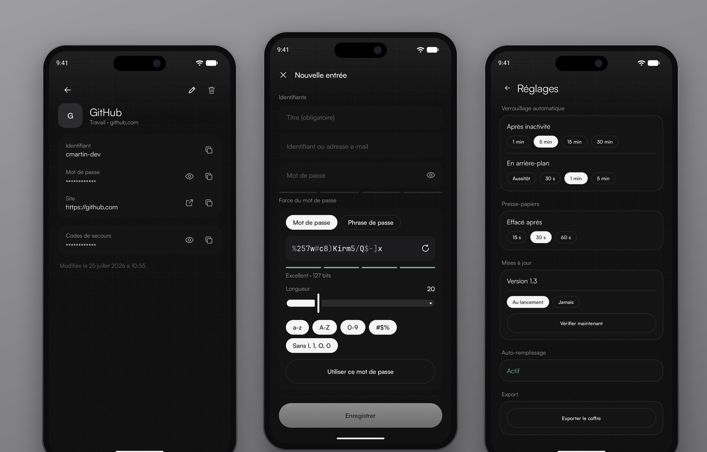
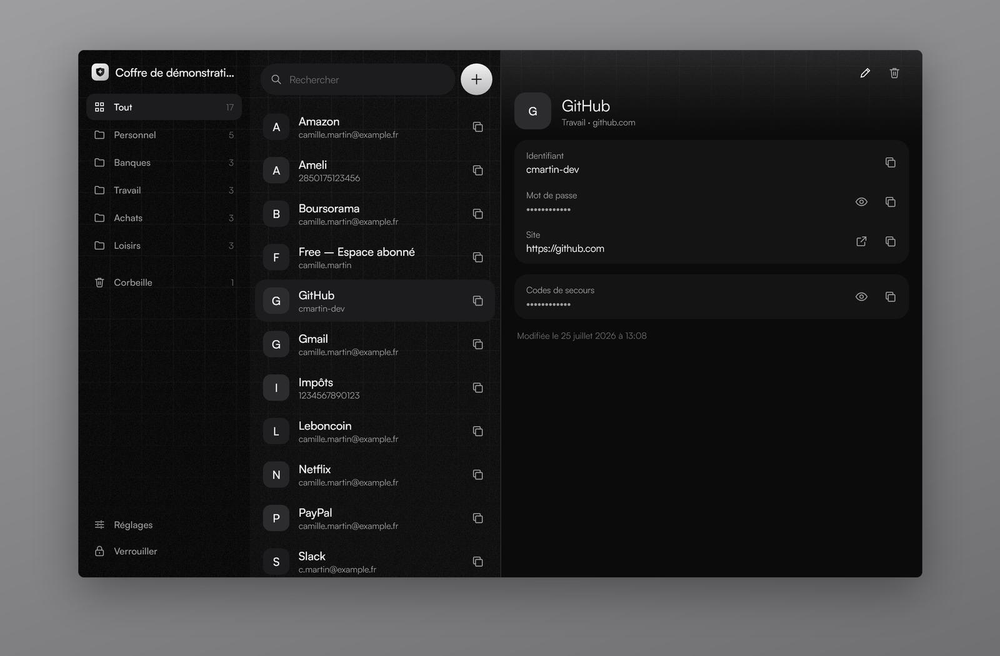
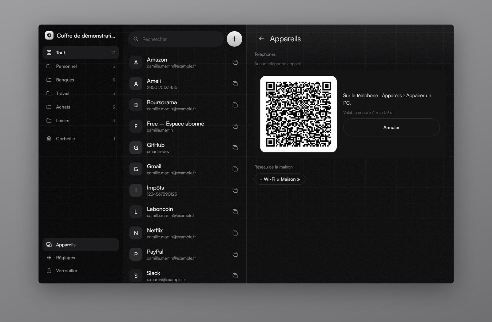
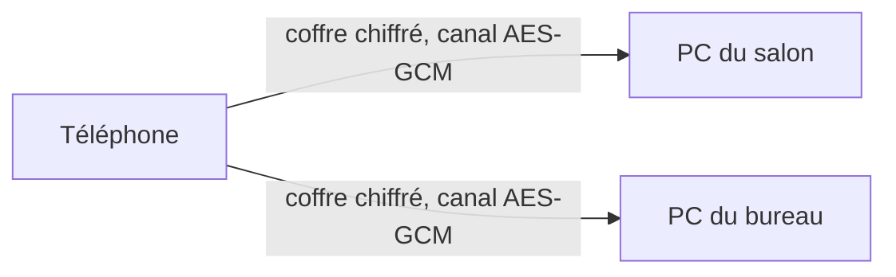
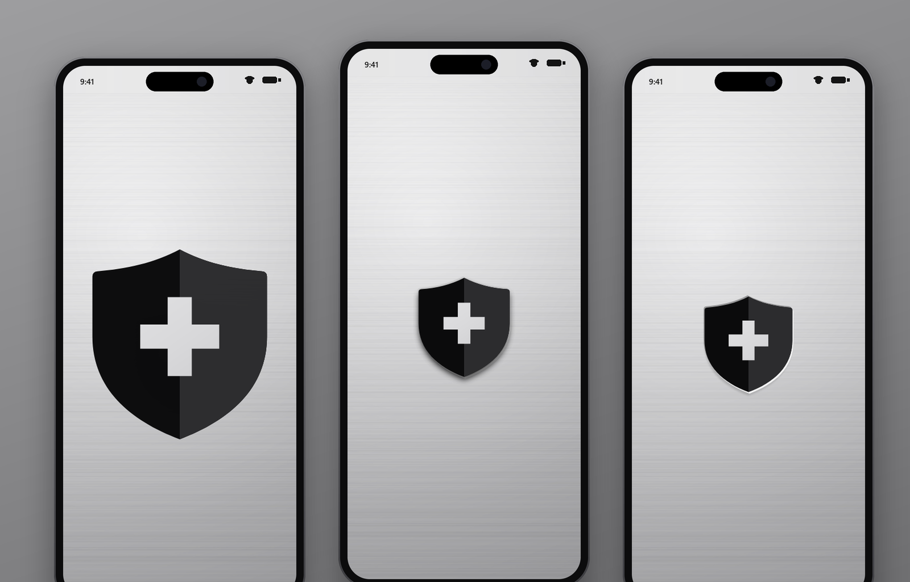

<p align="center">
  
</p>

<h1 align="center">KeePlus</h1>

<p align="center">
  Vos mots de passe, <b>bien gardés</b>.<br>
  Un coffre chiffré qui vit chez vous, sur votre PC et votre téléphone.<br>
  Pas de cloud, pas de compte, pas d'abonnement.
</p>

<p align="center">
  <a href="https://github.com/Maubin76/KeePlus/actions/workflows/ci.yml"></a>
  <a href="https://github.com/Maubin76/KeePlus/releases/latest"></a>
  
  
  
</p>

<p align="center">
  
</p>

## En bref

KeePlus garde tous vos identifiants dans **un seul coffre chiffré**, que vous emportez
sur votre téléphone et retrouvez sur votre PC.

- **Chez vous, et seulement chez vous** : le coffre ne quitte jamais vos appareils. Le
  téléphone et le PC se synchronisent **directement par le Wi-Fi de la maison**, sans
  serveur ni service en ligne.
- **Là où vous vous connectez** : sur le téléphone, KeePlus remplit les formulaires des
  applis et des sites ; sur le PC, un raccourci fait descendre une carte qui met vos
  comptes sous la main.
- **Au format KeePass** : le coffre est un fichier KDBX 4 standard. Vous pouvez l'ouvrir
  avec KeePassXC ou KeePassDX, et reprendre le vôtre dans KeePlus en deux gestes. Vos
  données ne sont jamais prisonnières.
- **Prudent par défaut** : verrouillage automatique, presse-papiers effacé après 30 s,
  écran protégé des captures, sauvegarde quotidienne du coffre chiffré.

## Auto-remplissage sur le téléphone

<p align="center">
  
</p>

Touchez un champ de connexion : KeePlus se propose au-dessus du clavier. Une petite carte
descend du haut de l'écran, par-dessus l'appli, et c'est tout.

- **Connexion** : les comptes de l'appli ou du site s'affichent ; quand il y en a
  plusieurs, l'identifiant passe en avant pour choisir le bon.
- **Inscription** : identifiant proposé et mot de passe généré, de la longueur voulue,
  remplis puis enregistrés dans le coffre.
- **Changement de mot de passe** : mot de passe actuel repris du coffre, nouveau mot de
  passe généré, entrée mise à jour ; l'ancien reste dans l'historique.
- **Identifiants tapés à la main** : Android propose de les enregistrer, KeePlus crée
  l'entrée ou la met à jour.
- **Sûr** : rien n'est rempli sans votre appui, et un site n'obtient que ses propres
  comptes. Fonctionne dans les applis, Chrome, Brave, Firefox, Edge et Samsung Internet.

## Saisie rapide sur le PC

<p align="center">
  
</p>

Dans n'importe quelle appli ou page de connexion, **Ctrl + Maj + Espace** (réglable) fait
descendre une carte du haut de l'écran. Elle reconnaît le site (lu dans la barre
d'adresse) ou l'appli, et propose **Connexion**, **Inscription** ou **Changer**.

Un **Ctrl + C** prépare tout : le **Ctrl + V** suivant colle l'identifiant, le suivant le
mot de passe (et, pour un changement, le mot de passe actuel puis le nouveau). Les secrets
restent hors de l'historique du presse-papiers de Windows et s'effacent d'eux-mêmes.

## Au quotidien

<p align="center">
  
</p>

<p align="center">
  
</p>

| Fonctionnalité | Description | Android | PC |
|---|---|:---:|:---:|
| **Coffre KeePass** | Format KDBX 4 (Argon2id, AES-256), compatible KeePassXC et KeePassDX | ✅ | ✅ |
| **Reprendre un coffre existant** | Un fichier `.kdbx` de KeePassXC ou KeePassDX devient le coffre de l'appareil | ✅ | ✅ |
| **Auto-remplissage** | Connexion, inscription, changement de mot de passe, enregistrement des saisies | ✅ | — |
| **Saisie rapide** | Carte appelée par un raccourci global, presse-papiers enchaîné | — | ✅ |
| **Recherche** | Instantanée, sans tenir compte des majuscules ni des accents | ✅ | ✅ |
| **Groupes et corbeille** | Rangement par groupe, corbeille avec restauration, suppression définitive | ✅ | ✅ |
| **Fiche** | Identifiant, mot de passe, site, notes, champs libres secrets ou non, anciennes versions | ✅ | ✅ |
| **Générateur** | Mots de passe ou phrases de passe, réglables, avec leur force | ✅ | ✅ |
| **Copie sécurisée** | Presse-papiers effacé après 15, 30 ou 60 s, exclu de l'historique | ✅ | ✅ |
| **Empreinte** | Déverrouillage biométrique ; mot de passe maître redemandé toutes les 24 h, 48 h ou chaque semaine | ✅ | — |
| **Verrouillage automatique** | Après inactivité, en arrière-plan, à l'extinction de l'écran ou au verrouillage de Windows | ✅ | ✅ |
| **Synchronisation Wi-Fi** | Appairage par QR code, échanges chiffrés sur le réseau de la maison seulement | ✅ | ✅ |
| **Sauvegardes** | Copie quotidienne du coffre chiffré, restauration en un clic | ✅ | ✅ |
| **Export** | Copie du coffre chiffré vers le fichier de votre choix | ✅ | — |
| **Mises à jour** | Nouvelle version proposée, vérifiée et installée par l'appli | ✅ | ✅ |
| **Zone de notification** | L'appli reste près de l'horloge, prête pour le téléphone ; démarrage avec Windows au choix | — | ✅ |
| **Raccourcis clavier** | Ctrl+F, Ctrl+N, Ctrl+B, Ctrl+Maj+C, Ctrl+U, Ctrl+L… | — | ✅ |
| **Démonstration** | Un coffre d'exemple, en mémoire seulement, pour tout essayer sans rien saisir | ✅ | ✅ |

## Synchronisation : le téléphone et le PC, sans nuage

<p align="center">
  
</p>

On appaire une fois : le PC affiche un QR code, le téléphone le scanne. Ensuite, dès que
le téléphone est sur le Wi-Fi de la maison, les deux coffres se tiennent à jour tout seuls,
au premier plan comme en tâche de fond.



- **Seul le fichier chiffré circule**, octet pour octet, dans un canal lui-même chiffré par
  une clé propre à chaque téléphone. Il n'est jamais déchiffré en route.
- **Un seul appareil a changé ?** L'autre reprend son coffre, même verrouillé.
- **Les deux ont changé ?** Le téléphone fusionne entrée par entrée au déverrouillage : la
  version la plus récente gagne, l'autre rejoint l'historique de l'entrée. Rien n'est perdu.
- **Le téléphone fait le relais** : il porte les modifications d'un PC à l'autre.
- **Seulement à la maison** : hors des réseaux enregistrés, rien n'est tenté, et le PC
  n'écoute pas.

## Une ouverture qui a du poids

<p align="center">
  
</p>

Au lancement sur Android, l'écran devient une plaque d'aluminium brossé ; le bouclier
tombe, s'écrase avec une vibration sourde et se grave dans le métal, puis laisse place
au déverrouillage.

## Sécurité

Le détail, expliqué sans prérequis et en schémas : [**la cryptographie de KeePlus**](doc/CRYPTOGRAPHIE.md).

| Sujet | Ce que fait KeePlus |
|---|---|
| **Chiffrement du coffre** | KDBX 4 : clé dérivée par Argon2id (64 Mio), contenu chiffré en AES-256 |
| **Mot de passe maître** | Jamais enregistré ; un mot de passe faible est refusé à la création |
| **Empreinte** | Mot de passe chiffré par une clé du Keystore, utilisable seulement après une empreinte forte, invalidée si une empreinte est ajoutée |
| **Auto-remplissage** | Aucune valeur transmise avant votre appui ; le domaine d'un site n'est cru que s'il vient d'un navigateur connu |
| **Écran** | Captures et aperçu dans les applis récentes interdits (Android) |
| **Presse-papiers** | Secrets marqués sensibles, exclus de l'historique et de la synchronisation de Windows, effacés après un délai réglable |
| **Verrouillage** | Inactivité, arrière-plan, extinction de l'écran, verrouillage de la session Windows |
| **Synchronisation** | Réseau local de la maison uniquement, appairage par QR code valable 5 minutes, messages scellés en AES-GCM, protection contre le rejeu |
| **Écritures** | Fichier écrit à part, relu, puis substitué : un coffre n'est jamais laissé à moitié écrit, et un coffre arrivé d'un autre appareil n'est jamais écrasé |
| **Réseau** | Aucune donnée envoyée : seule la vérification des mises à jour interroge GitHub |

## Installation

Téléchargez les fichiers de la [dernière release](https://github.com/Maubin76/KeePlus/releases/latest) :

- **Android** : `KeePlus-X.Y.apk`, à ouvrir sur le téléphone (Android autorise une fois
  l'installation depuis votre navigateur ou gestionnaire de fichiers). Pour
  l'auto-remplissage : Réglages de KeePlus › « Activer l'auto-remplissage » ; dans Chrome
  ou Brave, choisissez aussi « Saisie automatique avec un autre service ».
- **Windows** : `KeePlus-X.Y-windows.zip`, à décompresser où vous voulez, puis lancer
  `KeePlus.exe`. Aucune installation ni droit administrateur : la JVM est incluse.

Au premier lancement, créez votre coffre ou reprenez un coffre KeePass existant. Ensuite,
chaque nouvelle version vous est proposée par l'appli elle-même.

## Pour les développeurs

KeePlus est écrit en **Kotlin** avec **Compose Multiplatform** : l'interface est commune
au téléphone et au PC.

| Module | Rôle |
|---|---|
| `core` | Coffre KDBX (via [kotpass](https://github.com/keemobile/kotpass)), fusion, générateur, synchronisation, reconnaissance des formulaires, mises à jour (JVM pur) |
| `ui` | Interface commune : thème, logo, écrans, contrôleur de l'appli |
| `app` | Appli Android : empreinte, auto-remplissage, synchronisation en tâche de fond, scan du QR code |
| `desktop` | Appli Windows : zone de notification, carte de saisie, appairage, mise à jour du dossier portable |
| `demo` | « Démo Connexion », appli tierce (inscription, connexion, changement de mot de passe) pour essayer l'auto-remplissage |

```bash
bash ci/polices.sh                    # polices Satoshi (non versionnées, voir plus bas)
./gradlew :core:test :desktop:test    # tests
./gradlew :desktop:run                # appli PC
./gradlew :app:installDebug           # appli Android sur le téléphone branché (+ Démo Connexion)
./gradlew :desktop:packageZip         # dossier portable Windows (JDK avec jpackage)
```

- **CI** : à chaque push sur `main`, tous les tests, puis APK signé, appli PC portable et
  release GitHub, avec un numéro de version augmenté automatiquement.
- **Visuels de ce README** : captures brutes avec
  `KEEPLUS_CAPTURES=1 ./gradlew :desktop:test --tests "*ReadmeScreenshotsTest*"` (et captures
  de l'émulateur pour le téléphone), puis `python ci/vitrines.py` les pose dans leurs cadres.
- **Logo** : dessiné dans `ui/.../theme/Logo.kt` ; `LogoAssetsTest` régénère les icônes.
- **Direction artistique** : [`DESIGN.md`](DESIGN.md) ; intentions du produit : [`PRODUCT.md`](PRODUCT.md).

## Polices

- **Satoshi** © Indian Type Foundry, [licence ITF Free Font](licenses/Satoshi-FFL.txt) :
  intégrée à l'appli, mais sa licence interdit de la publier dans un dépôt. Elle est donc
  téléchargée depuis [Fontshare](https://www.fontshare.com/fonts/satoshi) à chaque
  construction (`ci/polices.sh`).
- **JetBrains Mono** © JetBrains, [licence SIL Open Font](licenses/JetBrainsMono-OFL.txt).
