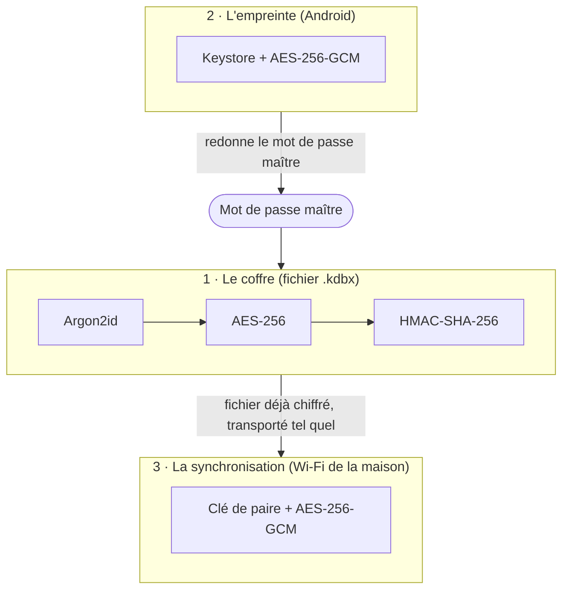
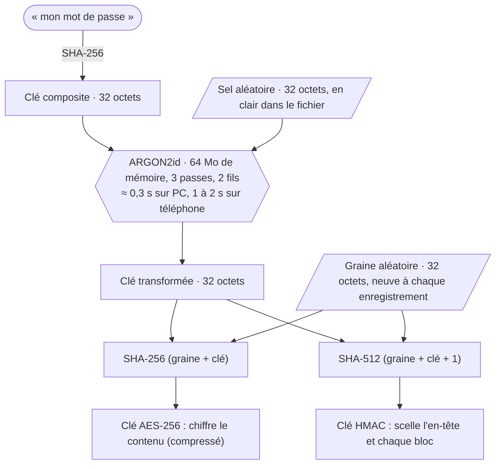
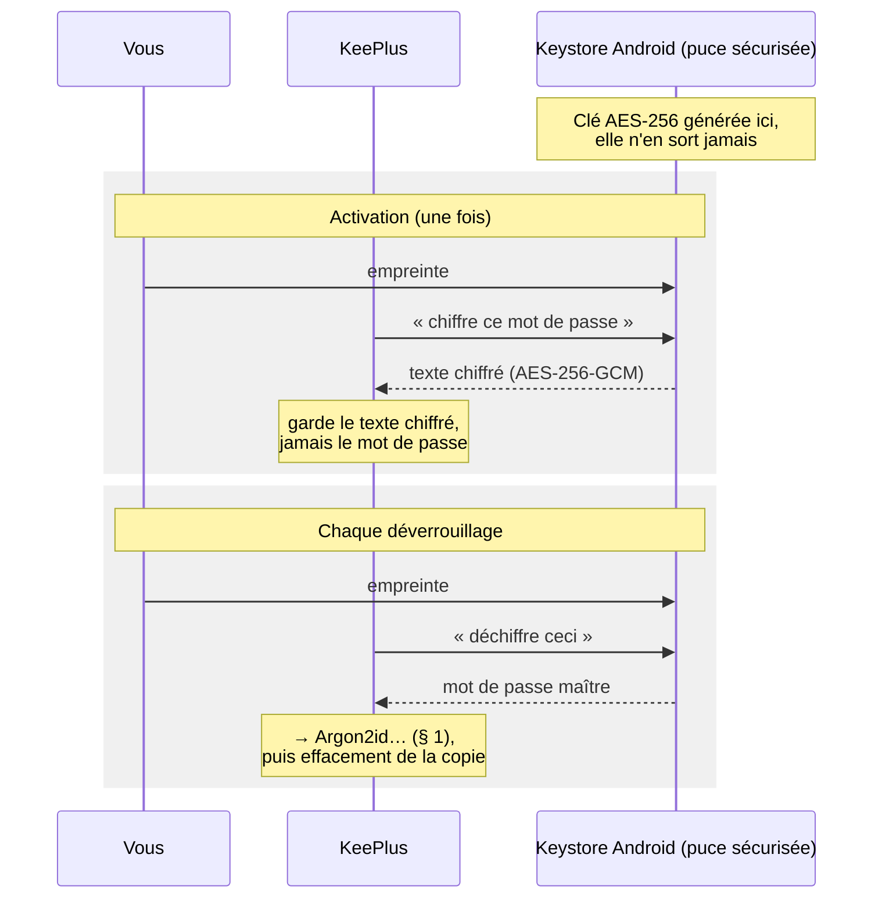
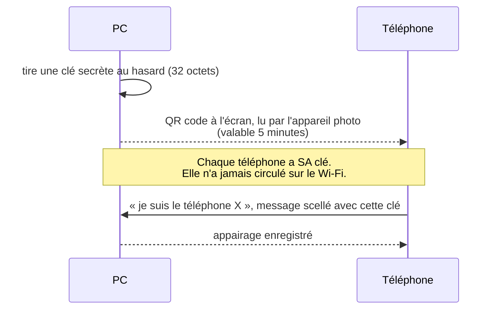
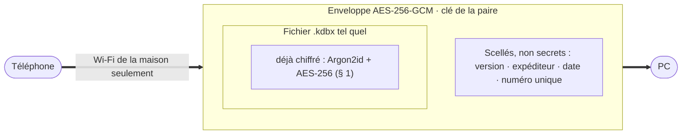

# La cryptographie de KeePlus

Ce document explique, sans prérequis d'expert, comment KeePlus protège vos mots de passe :
dans le fichier du coffre, derrière l'empreinte du téléphone, et pendant la synchronisation
par le Wi-Fi.

## Vue d'ensemble : trois couches, une seule clé maîtresse

Tout repose sur **votre mot de passe maître**. Les deux autres couches ne font que le
ressortir (l'empreinte) ou transporter le coffre déjà chiffré (la synchronisation).

---

## 1. Le coffre : du mot de passe à la clé de chiffrement

Le coffre est un fichier **KDBX 4**, le format de KeePass. Le mot de passe maître n'est
**jamais enregistré** : à chaque ouverture, la clé est **recalculée** à partir de lui.

### Les notions, une par une

| Notion | Image | Rôle dans KeePlus |
|---|---|---|
| **SHA-256** | Une empreinte digitale de données | Transforme un texte en 32 octets ; impossible de revenir en arrière, et un seul caractère changé donne une empreinte totalement différente. |
| **Argon2id** | Une serrure volontairement lente à tourner | Chaque essai de mot de passe coûte environ 0,3 s et 64 Mo de mémoire. Un voleur du fichier ne peut que deviner : au lieu de milliards d'essais par seconde, il en fait quelques-uns, et la mémoire exigée l'empêche de paralléliser à bas coût sur des cartes graphiques. |
| **Sel** | Un grain de sel propre à votre coffre | Deux personnes avec le même mot de passe obtiennent des clés différentes ; aucune table précalculée ne sert à l'attaquant. |
| **AES-256** | Le coffre-fort lui-même | Chiffrement standard des banques et des États. Sans la clé, le contenu est du bruit : 2²⁵⁶ clés possibles, plus que d'atomes dans l'univers observable. |
| **HMAC** | Un sceau de cire qu'on ne peut poser qu'avec la clé | Reconnaît un **mauvais mot de passe** (le sceau de l'en-tête ne correspond pas : « Mot de passe incorrect ») et détecte toute **modification** du fichier, volontaire ou due à un disque défaillant (« coffre endommagé »). |
| **Graine neuve** | Un emballage différent à chaque fois | Deux enregistrements au contenu identique donnent des fichiers entièrement différents : un observateur ne sait même pas si quelque chose a changé. |
| **ChaCha20 intérieur** | Une seconde enveloppe pour les secrets | À l'intérieur du fichier, les mots de passe des entrées sont encore chiffrés une fois (prévu par KDBX 4). |

> **À retenir** : la seule attaque réaliste contre un coffre volé est de **deviner le mot de
> passe maître**. Argon2id la rend très lente ; un mot de passe long la rend vaine. C'est
> pourquoi KeePlus refuse les mots de passe faibles à la création.

---

## 2. L'empreinte : un coffret dans la puce sécurisée du téléphone

L'empreinte ne remplace pas le mot de passe maître : elle le **ressort d'un coffret** que seul
votre doigt peut ouvrir.

- La clé est **créée dans la zone sécurisée du téléphone et n'en sort jamais**. KeePlus lui-même
  ne peut pas la lire : il demande seulement « chiffre » ou « déchiffre », et Android exige une
  empreinte forte à chaque fois.
- **GCM** chiffre et scelle en même temps : un texte chiffré trafiqué est refusé.
- **Une empreinte ajoutée au téléphone invalide la clé** : quelqu'un qui enregistrerait son
  propre doigt n'ouvrirait rien. KeePlus redemande alors le mot de passe maître.

---

## 3. La synchronisation : une enveloppe scellée autour du coffre déjà chiffré

### L'appairage : la clé passe par vos yeux, pas par le réseau

### Chaque échange : deux couches

- **Défense en profondeur** : même une enveloppe ouverte ne livrerait que le fichier `.kdbx`,
  qui exige encore le mot de passe maître. Le coffre n'est **jamais déchiffré en route**.
- **Enveloppe scellée (GCM)** : un message modifié, ou fabriqué sans la clé, est rejeté.
- **Contre le rejeu** : un espion pourrait enregistrer un message et le renvoyer plus tard pour
  remettre un ancien coffre. Chaque message porte une **date** (5 minutes de tolérance) et un
  **numéro à usage unique** jamais accepté deux fois ; chaque réponse est **liée à sa question**.
- **Seulement à la maison** : hors des réseaux enregistrés, le téléphone ne tente rien et le PC
  n'écoute pas.

> Les empreintes SHA-256 que la synchronisation compare servent seulement à savoir **qui a
> changé** de coffre depuis le dernier échange ; elles ne protègent rien.

---

## Ce qui n'est pas parfait

| Point | Explication |
|---|---|
| **Le mot de passe maître reste le maillon faible** | Argon2id ralentit l'attaquant, mais un mot de passe court se devine quand même. |
| **Pas de « confidentialité persistante »** | La clé d'une paire ne change pas : quelqu'un qui enregistrerait aujourd'hui le trafic puis volerait un jour cette clé pourrait ouvrir les enveloppes passées. Il n'obtiendrait que des coffres chiffrés, qui exigent encore le mot de passe maître. |
| **Coffre ouvert en mémoire** | Pendant que le coffre est ouvert, les secrets sont seulement masqués en mémoire (mélange XOR), ce qui gêne une lecture sans l'empêcher. Limite commune à tous les gestionnaires : un logiciel espion présent pendant l'ouverture peut tout voir. Le verrouillage automatique réduit cette fenêtre. |
| **Mises à jour du PC** | Le zip est vérifié par l'empreinte SHA-256 publiée par GitHub : on fait confiance à GitHub et à HTTPS. Sur Android, c'est plus solide : le nouvel APK doit en plus être **signé avec la même clé**, sinon Android refuse de l'installer. |

## En une phrase

**Sans votre mot de passe maître, votre coffre n'est qu'un fichier de bruit**, où qu'il se
trouve (disque, sauvegarde, Wi-Fi), et chaque tentative pour le deviner coûte cher.

---

Références : format KDBX 4 (KeePass), [kotpass](https://github.com/keemobile/kotpass),
Argon2 (RFC 9106), AES-GCM (NIST SP 800-38D), Android Keystore. Paramètres dans le code :
`core/.../vault/VaultCodec.kt` (Argon2id), `core/.../link/LinkCrypto.kt` (enveloppes),
`app/.../AndroidBiometric.kt` (empreinte).
